<div align="center">

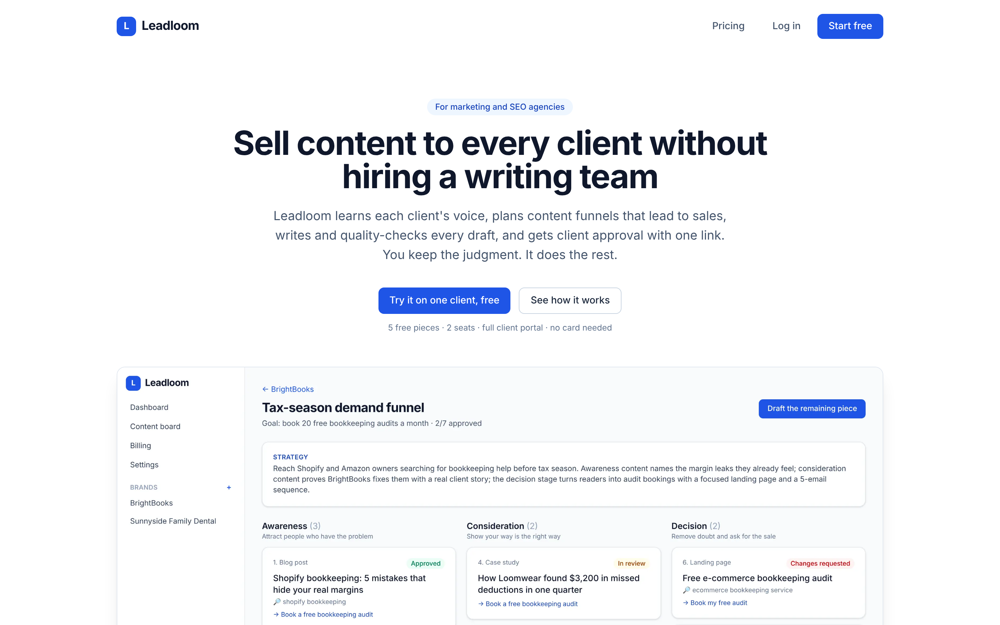

# Leadloom

### Content funnels that turn interest into customers

Plan and produce blogs, landing pages, email sequences, case studies and social posts that work together, written in each brand's own voice, quality-checked, reviewed by the client and delivered. All in one place.

[Features](#-features) · [Test plan](docs/TEST-PLAN.md) · [Sales kit](docs/SALES-KIT.md) · [How it works](#-how-it-works) · [Screenshots](#-screenshots) · [Pricing](#-pricing) · [Quick start](#-quick-start) · [Deploy](#-deploy-vercel--neon) · [Architecture](#-architecture)


</div>

---

## 💡 Why Leadloom

Most businesses don't need more content. They need content that **leads somewhere**: a blog post that sends readers to a case study, which sends them to a landing page, which an email sequence follows up on.

Content agencies sell exactly that, at **$1,000+ a month** per client, because it takes strategy, a writer who learns the brand's voice, reviews, revisions and reliable delivery. AI writing tools are cheap, but they produce one-off pieces with no strategy, no voice consistency, no quality control and no client workflow.

**Leadloom does the whole agency workflow, with AI doing the writing:**

| | Content agency | Generic AI writer | **Leadloom** |
|---|:---:|:---:|:---:|
| Learns the brand's voice | ✅ | ❌ | ✅ |
| Plans a connected funnel, not one-off posts | ✅ | ❌ | ✅ |
| Only uses real facts, never invents stats | ✅ | ❌ | ✅ |
| Quality check on every draft | ✅ | ❌ | ✅ |
| Client review and approval | ✅ | ❌ | ✅ |
| Revisions with version history | ✅ | ⚠️ | ✅ |
| Price per month | $1,000+ | $20–100 | **$49–399** |

**Who it's for**
- **Small and midsize businesses** that want a steady content engine without hiring an agency.
- **Marketing, SEO and web agencies** that want to offer content to their clients without building a writing team. The Agency plan includes a white-label client review portal.

---

## ✨ Features

### 🎙️ Brand voice profiles
Paste a few things the brand has already written. Leadloom builds a voice profile with tone, point of view, sentence style, words the brand uses, **words it would never use**, do's and don'ts, and real sample lines. Every draft is written to that profile.

### 🗺️ AI funnel planner
Enter a business goal ("book 20 free audits a month") and how many pieces you want. Leadloom maps a connected funnel across **awareness → consideration → decision**: each piece gets a format, a target keyword, an angle and a call to action that points to the **next piece in the funnel**.

### ✍️ Drafting in six formats
Blog posts · Landing pages · 5-email sequences · Case studies · LinkedIn posts · Newsletters. Each format has its own proven structure. The writer **only uses the brand's real proof points**; where a number would help but isn't provided, it writes a placeholder like `[ADD METRIC: hours saved]` instead of inventing one.

### ✅ Automatic quality check (0–100)
Every draft is scored by a deterministic QA engine. No AI guessing, the same input always gets the same score:

| Check | What it catches |
|---|---|
| Length | Too short or too long for the format |
| Readability | Flesch reading ease below plain English |
| Long sentences | Sentences over 30 words |
| AI-sounding phrases | "delve", "game-changer", "unlock the power", "in today's fast-paced world"… |
| Brand banned words | Anything on the brand's never-use list |
| Unsourced statistics | Percentages and "10x" claims with no source nearby |
| Target keyword | Missing from the title or intro |
| Structure | Too few sections; email sequences missing emails or subject lines |
| Call to action | No clear next step for the reader |
| Facts to fill in | Placeholders that must be resolved before delivery |

### 🔁 Revisions and version history
Edit the Markdown directly, or paste feedback ("shorter intro, add a pricing section") and let the AI revise. Everything else stays the same. Every version is saved and can be restored in one click.

### 🤝 Client review portal (no login)
Each brand gets a private review link. Clients read the content on any device, then **approve** or **request changes** with a comment. Their feedback lands on the content page and the board. On the Agency plan the portal is fully **white-label**, showing only your agency's name.

### 📋 Production board
Every piece across every brand on one board: Requested → Planned → Draft → In review → Changes requested → Approved → Delivered.

### 📦 Delivery
Copy as Markdown or download a `.md` file, ready for WordPress, Webflow, Ghost, Notion or Google Docs.

### 👥 Teams and accounts
Sign up and log in with email or **Continue with Google** (existing accounts are linked automatically). Invite teammates by email or link (per-plan seats), with owner and editor roles. Password reset, change password (signs out other devices) and full workspace deletion.

### 📧 Notifications
Email alerts when a client approves or requests changes, plus invite and password-reset emails (via Resend).

### 💳 Plans and billing
A one-time free trial, then Dodo Payments checkout, plan switching, the Dodo customer portal and webhooks, with monthly limits per plan. Dodo Payments is the merchant of record, so it handles global sales tax and VAT and pays out to you (works for founders in India and other countries where Stripe is limited).

---

## 🔄 How it works

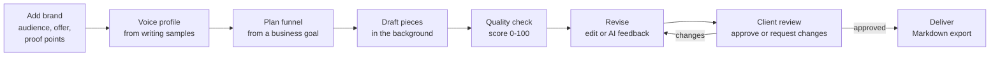

**A funnel Leadloom plans looks like this:**

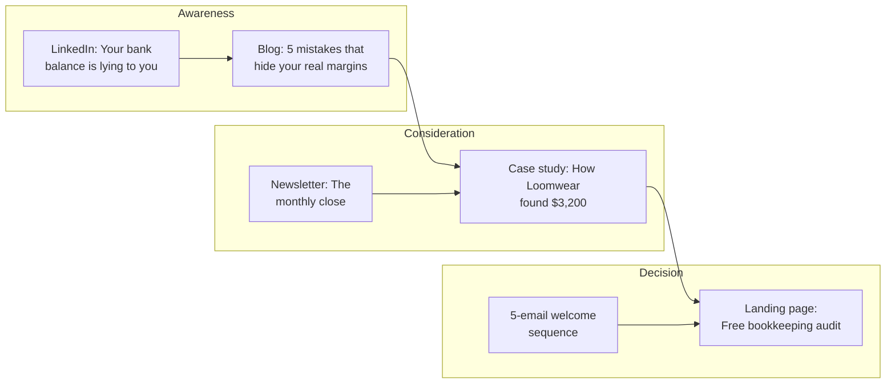

---

## 📸 Screenshots

### Dashboard
Everything that needs attention across all brands, at a glance.

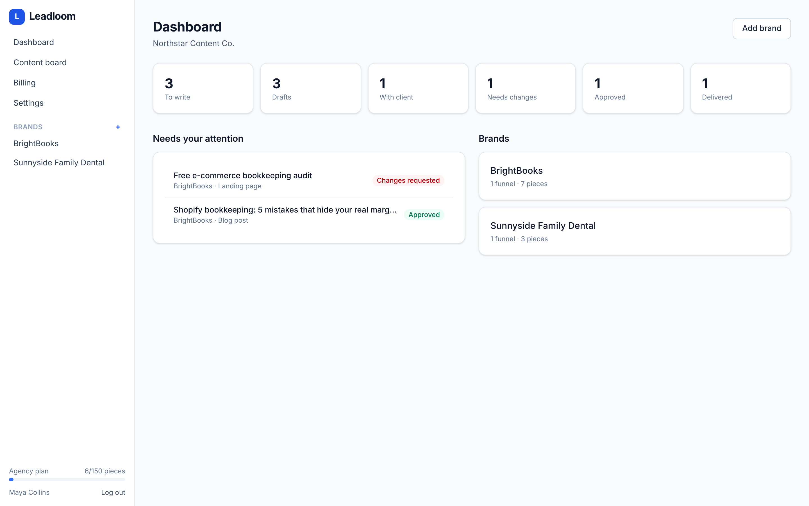

### Brand and voice profile
Ideal customer, offer, proof points and the learned voice profile, plus one-click funnel planning.

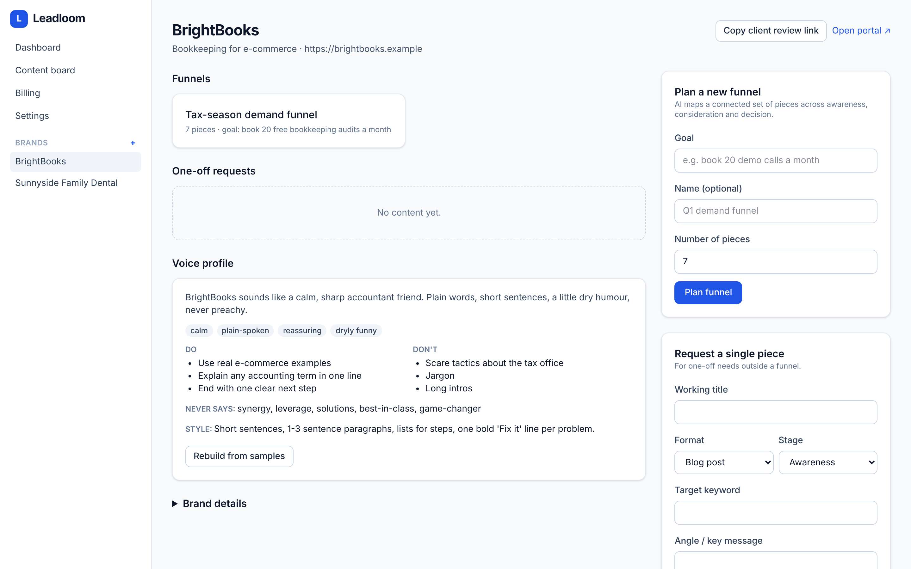

### Funnel map
A connected funnel across awareness, consideration and decision. Every piece knows where it sends the reader next.

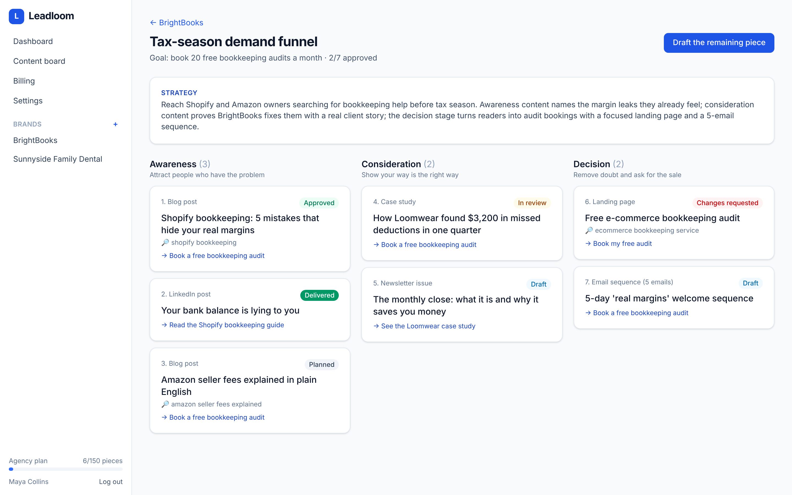

### Content editor with quality check
Preview or edit the draft, see the QA score, revise with AI and track every version.

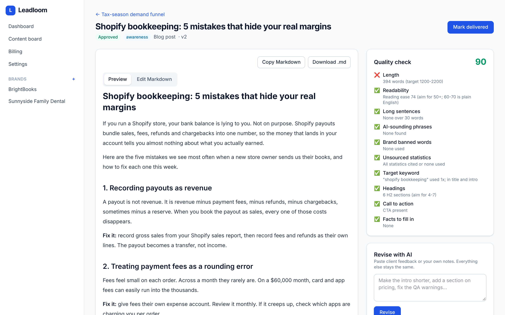

### Production board
Every piece, every brand, every stage.

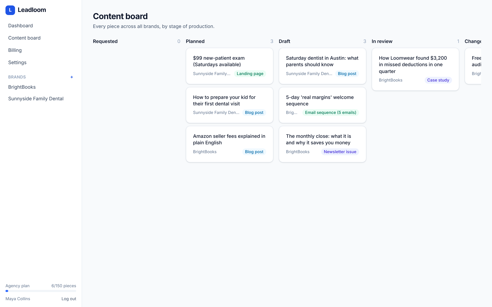

### Client review portal and billing

<table>
  <tr>
    <td width="30%" valign="top">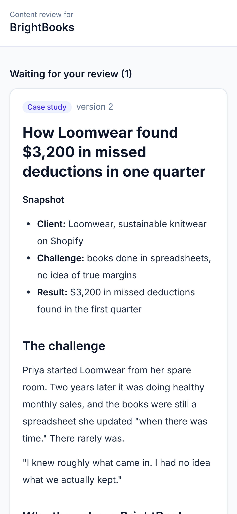<br/><sub>Client review on a phone. No account needed.</sub></td>
    <td width="70%" valign="top">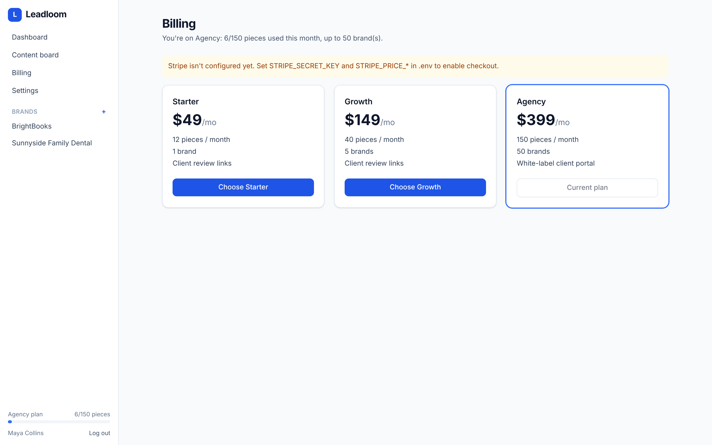<br/><sub>Plans and billing.</sub></td>
  </tr>
</table>

---

## 💰 Pricing

| Plan | Price | Pieces | Brands | Seats | Client portal |
|---|---|---|---|---|---|
| Free trial | Free | 5 (one-time) | 1 | 2 | Review links |
| Starter | $49/mo | 12 / month | 1 | 2 | Review links |
| Growth | $149/mo | 40 / month | 5 | 5 | Review links |
| **Agency** | **$399/mo** | **150 / month** | **50** | **15** | **White-label** |

AI revisions (3× the piece limit), funnel plans and voice profile builds have their own monthly caps, so a plan can't be used for unlimited free AI. Failed AI jobs are refunded automatically. Limits live in [`lib/plans.ts`](lib/plans.ts).

---

## 🚀 Quick start

**Requirements:** Node.js 20+ and a Postgres database (Neon, or local Postgres).

```bash
git clone https://github.com/Vpcodes11/LeadLoom.git
cd LeadLoom
npm install
cp .env.example .env
```

Fill in `.env` (see [Environment variables](#-environment-variables)). For a Neon database, the Neon CLI writes the connection strings for you:

```bash
neon env pull
```

Create the tables, load the demo data and start the app:

```bash
npx prisma migrate deploy
npm run db:seed
npm run dev
```

Open http://localhost:3000 and log in with **`demo@leadloom.dev` / `demo1234`**.

> **Demo mode:** without `GEMINI_API_KEY` or `ANTHROPIC_API_KEY`, the app runs with placeholder AI output, so you can click through every flow at no cost. Add a key to generate real voice profiles, funnel plans and drafts.

### Scripts

| Command | What it does |
|---|---|
| `npm run dev` | Start the dev server |
| `npm run build` | Generate Prisma client, apply migrations, production build |
| `npm start` | Run the production build |
| `npm test` | QA engine unit tests |
| `npm run db:seed` | Load the demo agency, brands, funnel and content |

---

## 🔐 Environment variables

| Variable | Required | Description |
|---|:---:|---|
| `DATABASE_URL` | ✅ | **Pooled** Postgres URL (Neon `-pooler` host). Used by the app. |
| `DATABASE_URL_UNPOOLED` | ✅ | **Direct** Postgres URL. Used by Prisma Migrate. |
| `AUTH_SECRET` | ✅ | Signs session cookies. `openssl rand -hex 32` |
| `APP_URL` | ✅ | Public URL, used for checkout redirects and client review links. |
| `CRON_SECRET` | ✅ | Protects `/api/jobs/run`, the stuck-job recovery endpoint. `openssl rand -hex 32` |
| `GEMINI_API_KEY` | For real AI (free) | Google Gemini API key from [AI Studio](https://aistudio.google.com/apikey). Free tier, rate-limited. Takes priority when set. |
| `GEMINI_MODEL` | Optional | Defaults to `gemini-3.8-flash`. |
| `ANTHROPIC_API_KEY` | For real AI (paid) | Claude API key. Used when no Gemini key is set, or with `AI_PROVIDER=claude`. |
| `AI_PROVIDER` | Optional | `gemini` or `claude` to force a provider when both keys are set. |
| `GOOGLE_CLIENT_ID` / `GOOGLE_CLIENT_SECRET` | For Google sign-in | OAuth web client from Google Cloud Console. Redirect URI: `{APP_URL}/api/auth/google/callback`. The button is hidden until both are set. |
| `RESEND_API_KEY` | For email | Resend API key. Without it, invites show a copyable link and emails are logged. |
| `EMAIL_FROM` | For email | Sender, e.g. `Leadloom <noreply@yourdomain.com>` (domain verified in Resend). |
| `SUPPORT_EMAIL` | Recommended | Contact address shown on the Terms and Privacy pages. |
| `DODO_PAYMENTS_API_KEY` | For billing | Dodo Payments API key (Developer → API Keys), created in the same mode as below. |
| `DODO_PAYMENTS_WEBHOOK_KEY` | For billing | Signing secret of the webhook below. |
| `DODO_PAYMENTS_ENVIRONMENT` | For billing | `test_mode` or `live_mode`. |
| `DODO_PRODUCT_STARTER` / `_GROWTH` / `_AGENCY` | For billing | Product IDs (`pdt_...`) of the three monthly subscription products. |

---

## ☁️ Deploy (Vercel + Neon)

1. **Database (Neon).** The project is linked to Neon through [`neon.ts`](neon.ts). Run `neon deploy` to provision it and pull `DATABASE_URL` and `DATABASE_URL_UNPOOLED`.
2. **App (Vercel).** Import this repository at [vercel.com/new](https://vercel.com/new) and add the environment variables above. Keep **Fluid compute** enabled.
3. **Deploy.** The build runs `prisma migrate deploy`, so the schema is applied automatically.
4. **Dodo Payments.** Create three monthly subscription products (Starter $49, Growth $149, Agency $399) and copy their product IDs. Add a webhook endpoint `https://YOUR_DOMAIN/api/billing/webhook` subscribed to all `subscription.*` events and copy its signing secret. After checkout, Dodo returns the customer to `/api/billing/return`, which links the subscription to the workspace. Test the whole flow in test mode first, then switch `DODO_PAYMENTS_ENVIRONMENT` to `live_mode` with live keys and live product IDs.
5. **Health check.** `GET /api/health` checks the database and reports which integrations (AI, billing, email) are configured. Point an uptime monitor at it.
6. **Cron.** [`vercel.json`](vercel.json) calls `/api/jobs/run` once a day (the Vercel Hobby limit) to retry stuck AI jobs. On Vercel Pro, change the schedule to `*/5 * * * *` for faster recovery.

---

## 🏗️ Architecture

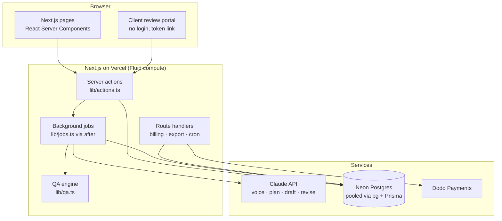

**Design decisions**
- **AI work never blocks a request.** Drafts and revisions are queued as `Job` rows and run with `after()` once the response is sent, 3 at a time. Pages refresh themselves until the work is done. A job is claimed atomically, so it never runs twice, and a cron route recovers jobs whose runner crashed.
- **Facts stay real.** The writer prompt only allows claims from the brand's proof points. Missing numbers become `[ADD METRIC]` placeholders, and general statistics get `[SOURCE]` tags that the QA engine flags.
- **Deterministic QA.** Quality scoring is plain TypeScript, not another AI call: fast, free, explainable and unit-tested.
- **Structured AI output.** Voice profiles and funnel plans use Claude structured outputs validated with Zod schemas, so the app never parses free text.
- **Database connections (Neon best practice).** The app uses node-postgres on the pooled URL with Prisma's `pg` adapter and Vercel's `attachDatabasePool`; migrations use the direct URL through Prisma's `directUrl`.
- **Abuse protection.** Monthly per-action AI caps, plus Postgres-backed rate limits on signup and login that work across serverless instances.

### Tech stack

| Layer | Choice |
|---|---|
| Framework | Next.js 15 (App Router, server actions, `after()`) |
| Language | TypeScript (strict) |
| UI | Tailwind CSS v4 |
| Database | Neon Postgres, Prisma 6 with the `pg` driver adapter |
| AI | Anthropic Claude via `@anthropic-ai/sdk`, structured outputs, server-side refusal fallback |
| Auth | Email and password (bcrypt) and Google sign-in (OAuth 2.0 + PKCE), signed JWT session cookie (`jose`) |
| Billing | Dodo Payments (merchant of record): hosted checkout, plan changes, customer portal, Standard Webhooks signatures |
| Hosting | Vercel (Fluid compute, Cron) |

### Project structure

```
app/
  page.tsx                  Marketing landing page
  login/ signup/            Auth pages
  app/                      Signed-in app
    page.tsx                Dashboard
    brands/                 Brands, voice profile, funnel planner
    funnels/[id]/           Funnel map
    content/[id]/           Editor, QA, revisions, comments
    board/                  Production board
    billing/ settings/
  review/[token]/           Client review portal (no login)
  api/
    export/[id]/            Markdown download
    jobs/run/               Cron: recover stuck AI jobs
    billing/                Dodo Payments checkout, return, portal, webhook
components/                 UI building blocks
lib/
  ai.ts                     Claude prompts and calls (voice, plan, draft, revise)
  jobs.ts                   Background job queue
  qa.ts                     Quality check engine (+ qa.test.ts)
  actions.ts                Server actions
  plans.ts usage.ts         Plans and limits
  ratelimit.ts auth.ts db.ts
prisma/
  schema.prisma             Data model
  migrations/               SQL migrations
  seed.ts                   Demo data
docs/screenshots/           README images
```

---

## 🧪 Testing

```bash
npm test
```

Unit tests cover the QA engine: word counting, readability, clichés, banned words, unsourced stats, keyword placement and email structure.

The full flow has also been tested end to end in a real browser: signup → brand → voice profile → funnel plan → background drafting → edit → send to client → client requests changes on mobile → board → plan limits → login rate limit → billing; and invite → accept → seat limit → password reset (signs out other devices) → change password → remove teammate → delete workspace. Both suites pass against the live production deployment.

---

## 🗺️ Roadmap

- [ ] Live SEO data (keyword volume and difficulty) in the funnel planner
- [ ] One-click publishing to WordPress, Webflow, Ghost and Google Docs
- [ ] Team members with roles, assignments and due-date reminders
- [ ] Performance loop: connect Search Console and Analytics, refresh underperforming pieces
- [ ] Optional human editor pass as a premium add-on

---

<div align="center">

**Leadloom**: strategy, writing, quality control and client delivery in one workflow.

© Leadloom. All rights reserved.

</div>
